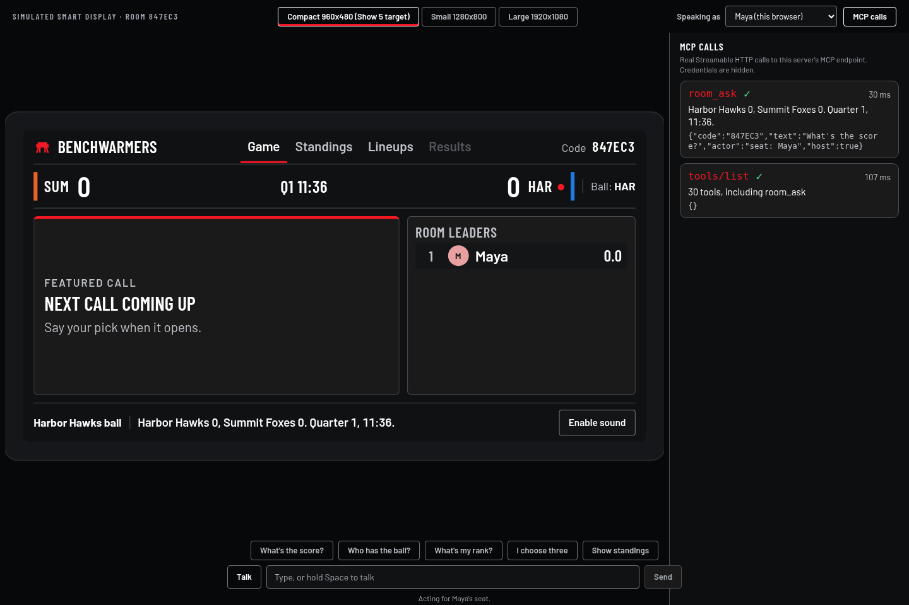
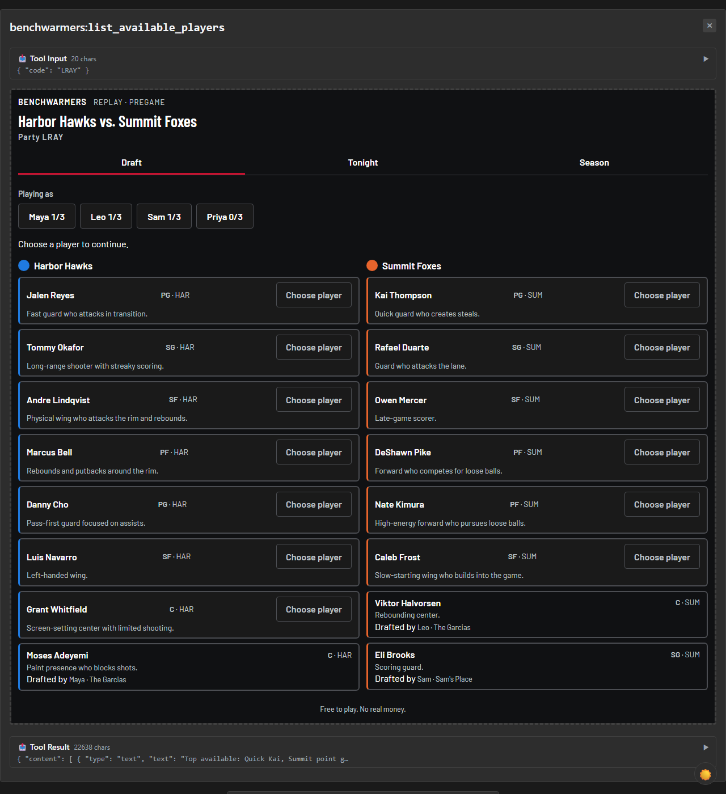
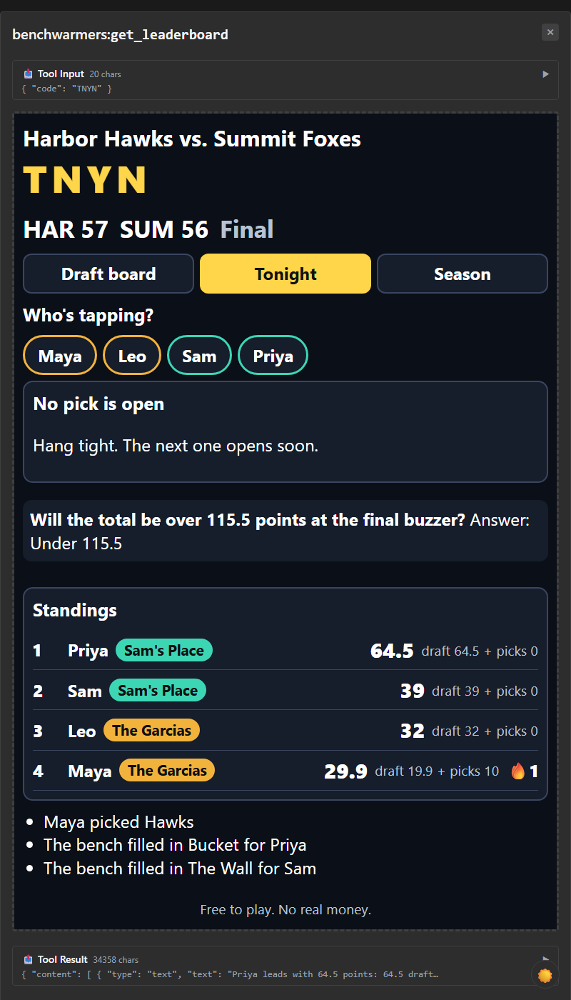
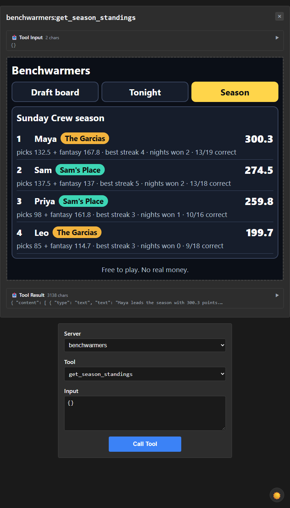
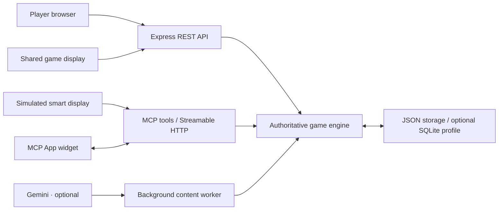

# Benchwarmers

**Draft your squad. Call the next play. Prove you know ball.**

[](LICENSE)
[](https://nodejs.org/)
[](https://modelcontextprotocol.io/)

[Open the demo](https://benchwarmers.fly.dev) · [Run locally](#quick-start) · [Try the smart display](#simulated-smart-display) · [Judge testing guide](docs/TESTING.md)

## About

Benchwarmers turns watching sports with friends into a shared game night. Create a room, build a fantasy lineup, make timed predictions, and follow the standings together—from the same couch or different cities.

Built for the **main Alexa+ hackathon track**, the project includes a **simulated smart display backed by real MCP calls**. The standard demo uses fictional basketball and football replays. No account, paid subscription, API key, or Echo device is required.

**License: [MIT](LICENSE)** · Copyright © 2026 Kevin Jiang. The project code is open source; third-party assets and data retain their own [attributions](#credits-and-attribution).



*A connected demo session: shared game state on the display, inspectable MCP calls alongside it. Create your own room to try it.*

<details>
<summary><strong>On this page</strong></summary>

- [Features](#features)
- [Quick start](#quick-start)
- [Play a game](#play-a-game)
- [Simulated smart display](#simulated-smart-display)
- [Architecture](#architecture)
- [Development](#development)
- [Configuration](#configuration)
- [FAQ](#faq)
- [Documentation](#documentation)
- [Credits and attribution](#credits-and-attribution)

</details>

## Features

| Feature | What you can do |
| --- | --- |
| **Room-based multiplayer** | Host a party and invite friends with a room code. |
| **Fantasy lineups** | Choose one captain and four flex athletes within the salary cap. |
| **Timed predictions** | Call the next play before the server closes the question window. |
| **Shared game display** | Follow the score, current question, play feed, and room standings together. |
| **Simulated smart display** | Ask about the game and inspect the MCP tools behind each response. |
| **Saved seasons** | Return to persisted room history and season standings. |
| **Replay controls** | Start, pause, resume, and choose 1–4× speed from the host's browser. |
| **Optional AI** | Enable Gemini for generated content and the household assistant; use fallback/offline defaults without model credentials. |

## Quick start

Requires **Node.js 22+**, **npm**, and **Git**. A recent desktop Chrome browser is recommended for the simulator and optional speech controls.

```sh
git clone https://github.com/Azrkiel/Benchwarmers.git
cd Benchwarmers
npm ci
npm run demo
```

Open `http://localhost:3001` in your browser. The demo command builds the MCP widget and web interface, then serves the app and API together. Stop it with **Ctrl+C**.

No `.env` file is needed for the default demo. Existing shell settings take precedence, so use `AI_MODE=fallback` and `ASSISTANT_MODE=offline` if you have previously configured another mode.

<details>
<summary><strong>CPU-only Linux: installation fails while downloading optional GPU binaries</strong></summary>

ONNX Runtime can attempt an additional GPU download during installation. Its supported override retains the bundled CPU runtime and skips those extra binaries:

```sh
ONNXRUNTIME_NODE_INSTALL=skip npm ci
npm run demo
```

This preserves TLS and package-integrity verification. GPU inference is not required for the standard demo.

</details>

<details>
<summary><strong>Change the port or replay speed</strong></summary>

Bash / Git Bash:

```sh
PORT=3031 ROOM_SPEED=4 npm run demo
```

PowerShell:

```powershell
$env:PORT = '3031'
$env:ROOM_SPEED = '4'
npm run demo
```

Open the selected port in your browser. The host can also change replay speed during the game.

</details>

## Play a game

1. **Host:** choose **Host a party**, select basketball or football, and create a room.
2. **Join:** enter your name, select a captain and four flex players, and save your lineup.
3. **Invite:** share the room code. Use separate browser profiles, private windows, or devices for additional players. On local Wi-Fi, use the LAN address printed by the demo command.
4. **Open the simulator:** follow the [smart-display walkthrough](#simulated-smart-display) in another tab of your host browser.
5. **Start:** return to your player tab, expand **Host controls**, and select **Start game**. Select **Open shared screen** for a larger game view.
6. **Play:** submit predictions while their windows are open, watch the standings update, and review the final and season results.

The server controls deadlines and scoring. Room credentials are saved automatically in your browser. Keep the host session to retain host controls, and create a fresh room for each independent test.

## Simulated smart display

**Make this part of your first walkthrough:** it connects the game-night experience to the project's MCP integration.

1. On your room's player page, expand **Host controls**.
2. Select **Open simulated smart display**, opening it in a new tab in the **same browser profile** where you joined.
3. In **Ask the display**, type **“What's the score?”** and select **Send**.
4. Select **MCP calls** to inspect the actual `room_ask` request and response.
5. Choose your seat in **Speaking as** when making player-specific requests. Guest mode supports public score and standings questions.

| Screen | Path on your running app |
| --- | --- |
| Player page | `/room/YOUR_ROOM_CODE` |
| Simulated smart display | `/display/room/YOUR_ROOM_CODE` |
| Shared game screen | `/room/YOUR_ROOM_CODE/display` |

For the hosted demo, append `/display/room/YOUR_ROOM_CODE` to the demo address. Replace `YOUR_ROOM_CODE` with the code from your own room. For a local demo, use the same path on your local server.

Try **“Who has the ball?”**, **“What's my rank?”**, or **“Show standings.”** Typed input is enough to test the flow; microphone access is optional. No manual MCP bearer setup is needed in the simulator.

See the [complete judge testing guide](docs/TESTING.md) for credentials, local setup, and the evaluation walkthrough.

<details>
<summary><strong>Explore the MCP App widget</strong></summary>

The household experience also includes an MCP App widget for drafting, picks, and season standings. These captures show the widget inside an MCP host.

[](docs/img/basic-host-draft-1280.png)

| Predictions | Season standings |
| --- | --- |
| [](docs/img/basic-host-tonight-1280.png) | [](docs/img/basic-host-season-1280.png) |

Select an image to open the full-size capture. [MCP host setup →](docs/MCP_HOSTS.md)

</details>

## Architecture



- **One source of truth:** the server validates lineups, prediction cutoffs, accepted actions, scores, and season results.
- **Real MCP transport:** the simulator uses the same-origin `/api/mcp-widget` gateway. External MCP hosts connect to authenticated `/mcp`.
- **Predictable gameplay:** the game engine determines results. Optional model generation provides wording and content; MCP tools read stored state.
- **Credential-free defaults:** committed content and the offline assistant keep the core scripted workflow usable without model access.

| Layer | Technologies |
| --- | --- |
| Interface | React, TypeScript, Vite, CSS |
| Service | Node.js, Express, Zod |
| Assistant and widgets | MCP TypeScript SDK, MCP Apps, optional Gemini |
| Persistence | JSON by default; optional SQLite profile |
| Experimental voice ID | Transformers.js, WavLM, ONNX Runtime, MFCC fallback |
| Verification | Vitest, Playwright, real HTTP/MCP smoke checks |

## Development

Install dependencies with `npm ci`, then build the widget before starting the watch processes:

```sh
npm run build:widget -w server
npm run dev
```

Vite serves the interface on port **5173** and proxies API/MCP requests to the server on **3001**. The service and web interface both reload during development.

| Command | Purpose |
| --- | --- |
| `npm run demo` | Build and run the combined app on port 3001. |
| `npm run dev` | Run the service and Vite in watch mode. |
| `npm test` | Run the server and web test suites. |
| `npm run typecheck` | Check server, widget, and web types. |
| `npm run build:widget -w server` | Build the single-file MCP widget. |
| `npm run build` | Build the web application. |
| `npm run qa:smoke` | Check room play, authorization, typed assistant/MCP, and persistence across restart on an isolated server. |
| `npm run qa:browser` | Run connected Playwright browser acceptance. |
| `npm run test:integration-tools` | Test the integration tooling. |
| `npm run demo:basketball` | Start an isolated basketball rehearsal on port 3037. |

Browser acceptance needs Chromium: use `npx playwright install chromium` or set `CHROMIUM_PATH` to a trusted installed executable. Get current test totals from the runner output.

<details>
<summary><strong>Connect MCP Inspector or another MCP host</strong></summary>

Start the local demo, then run:

```sh
npx @modelcontextprotocol/inspector
```

Choose **Streamable HTTP**, enter `http://localhost:3001/mcp`, and add this header in **Server Settings → Custom Headers** for the unmodified local defaults:

```text
Authorization: Bearer dev-token-change-me
```

A custom `MCP_TOKEN` replaces that local default. It is not a credential for the hosted service. The integrated server exposes 30 tools; use `tools/list` to inspect the running candidate. Protocol: `2025-11-25`.

The surface includes room creation, joining, lineups, predictions, standings, `room_status`, and `room_ask`, plus household tools. Additional gated tools do not enable their features in ordinary startup. Resources include `benchwarmers://rules`, `benchwarmers://room-rules`, and the widgets' `ui://` HTML.

[Host examples and authentication details →](docs/MCP_HOSTS.md)

</details>

<details>
<summary><strong>Repository map and additional routes</strong></summary>

```text
server/          Game engine, REST API, MCP tools, widget, storage, assistants
web/             Player interface, shared displays, simulator, voice lab
scripts/         Demo launchers and integration checks
extension/       Optional YouTube overlay browser extension
tools/odds/      Historical football drive-percentage aggregation
docs/            Testing, configuration, integration guides, and feedback
docs/img/        Public screenshots
FRICTION_LOG.md  Current developer-experience feedback
LICENSE          MIT license
```

The older household workflow remains available at `/tv/DEMO`, `/device/garcias`, `/device/sams-place`, and `/display/garcias`. Its three-player drafts are separate from room play's captain-plus-four lineup. `npm run demo:reset` resets only the legacy `DEMO` household party and season data.

Use `/voice-lab` with the Vite development server for experimental voice-ID enrollment and calibration. The optional YouTube overlay has its own [setup guide](extension/README.md).

</details>

## Configuration

Configuration is optional for the standard demo. To customize it, create a root `.env` from [`.env.example`](.env.example) if one does not already exist. The server loads it at startup; exported shell variables win. Restart after editing.

| Variable | Default | Purpose |
| --- | --- | --- |
| `PORT` | `3001` | Server port. |
| `ROOM_SPEED` | `1` | Initial room replay speed, from 1–4×. |
| `ROOM_DATA_FILE` | `data/rooms.json` | Saved room/season JSON path, relative to the server workspace. |
| `DATA_FILE` | `data/store.json` | Saved legacy household state, relative to the server workspace. |
| `AI_MODE` | `fallback` | Background content: `fallback` or `gemini`. |
| `ASSISTANT_MODE` | `offline` | Household assistant: `offline` or `gemini`. |
| `MCP_TOKEN` | `dev-token-change-me` | Bearer credential for external MCP clients. |
| `BW_API_URL` | `http://localhost:3001` | API target used by the Vite proxy. |

<details>
<summary><strong>Gemini, logging, and advanced settings</strong></summary>

Gemini is opt-in. Set the relevant mode to `gemini` and provide server-side credentials. Full setup, key failover, and model configuration are covered in the [Gemini guide](docs/GEMINI.md).

| Variable | Default | Purpose |
| --- | --- | --- |
| `GEMINI_API_KEY` | Unset | A single server-side key. |
| `GEMINI_API_KEYS` | Unset | Comma-separated pool; takes precedence over the single key. |
| `GEMINI_MODEL_ID` | `gemini-3.8-flash` | Model identifier. |
| `GEMINI_KEY_COOLDOWN_MS` | `60000` | Cooldown after quota, server, or network failures. |
| `GEMINI_TIMEOUT_MS` | `60000` | Total deadline for a model request, including failover. |
| `SPEED` | Demo launcher: `4` | Legacy household replay multiplier. |
| `ALLOWED_HOSTS` | Unset | Optional MCP Host allowlist; include the actual hostnames used by clients. |
| `AI_LOG`, `ASSISTANT_LOG` | On | Set to `0` to silence the corresponding logs. |

Keep `.env` private. Model keys stay on the server and must not use a `VITE_` prefix.

</details>

## FAQ

<details>
<summary><strong>Does this run on an actual Alexa or Echo device?</strong></summary>

The current experience is a browser-based Alexa+ simulation backed by real MCP calls. Physical Echo execution and a native Alexa+ host have not been verified. Typed simulator interactions are part of the tested workflow; speech controls depend on browser support and microphone permission.

</details>

<details>
<summary><strong>Can friends join from different devices?</strong></summary>

Yes. Use the hosted demo, or share the local server's printed LAN address with devices on the same Wi-Fi. Each person joins with the room code. Local browser credentials preserve their seat. A separate browser profile or private window lets you test another player on one computer.

Keep the simulator in the same profile as its player to make private actions available. Guest mode can still ask public score and standings questions.

</details>

<details>
<summary><strong>Can I replay a real game?</strong></summary>

The optional importer accepts a completed football matchup, ESPN event ID, or game URL. It converts the public ESPN summary into a replay and caches imports in ignored `server/data/imported-games/`.

Example API request: `POST /api/games/import` with `{"query":"UVA vs FSU 2025"}`. `GET /api/games` lists available replays.

This requires network access to ESPN's unofficial API, which may change or rate-limit. It supports completed-game replays, not a live sports feed. The committed demo games remain fictional.

Football prediction percentages use derived historical drive statistics. [Data source, method, and attribution →](tools/odds/README.md)

</details>

<details>
<summary><strong>What are the current limitations?</strong></summary>

- Experimental voice ID has synthetic-voice measurements, not verified real-person accuracy. Model downloads and browser speech services may require network access.
- Threaded voice inference needs isolation headers, supplied by the Vite development/preview servers; other hosting must configure them separately.
- External MCP authentication uses a static bearer token. Room credentials and the optional session boundary are described in the [security guide](docs/ROOM_SECURITY.md).
- Calls, point commitments, pregame picks, and live-provider features are disabled in ordinary startup. The standard game uses in-game points only.

Known tooling issues and actionable feedback are collected in the [friction log](FRICTION_LOG.md).

</details>

## Documentation

| Guide | Start here for |
| --- | --- |
| [Testing instructions](docs/TESTING.md) | The judge walkthrough, smart display, and local credentials. |
| [Room gameplay](docs/ROOM_DEMO.md) | Football rooms, invitations, predictions, and saved seasons. |
| [MCP host integration](docs/MCP_HOSTS.md) | Inspector, external widget hosts, and tunnels. |
| [Gemini configuration](docs/GEMINI.md) | Optional model access, deadlines, and key failover. |
| [Voice ID](docs/VOICE_ID.md) | Local embeddings, calibration, privacy, and limitations. |
| [Room security](docs/ROOM_SECURITY.md) | Credentials and the optional HTTPS session boundary. |
| [Friction log](FRICTION_LOG.md) | Developer-experience findings and improvement suggestions. |
| [Product feedback](docs/PRODUCT_FEEDBACK.md) | Tool-by-tool feedback from development. |

Questions or contributions? [Open an issue](https://github.com/Azrkiel/Benchwarmers/issues) or submit a pull request. Include reproduction steps and run the relevant tests, type checks, and builds for code changes.

## Credits and attribution

Benchwarmers code is available under the [MIT license](LICENSE). Third-party assets and data retain their respective terms:

- **Fonts:** Barlow, Barlow Condensed, and Big Shoulders Display; license files are included in [web/public/fonts](web/public/fonts).
- **Audio:** see the included [sound attribution](web/public/audio/ATTRIBUTION.md).
- **Historical football statistics:** derived nflverse data, CC BY 4.0; [method and attribution](tools/odds/README.md).
- **Experimental speaker model:** Microsoft WavLM / UniSpeech, ONNX conversion by Xenova; [model sources and licensing notes](docs/VOICE_ID.md#license).

[Back to top ↑](#benchwarmers)
