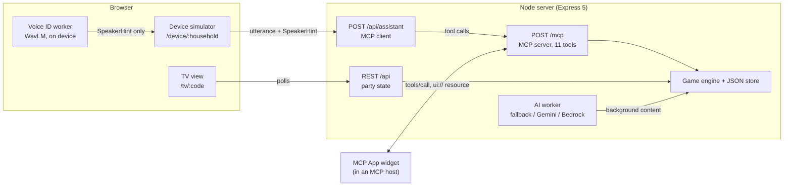
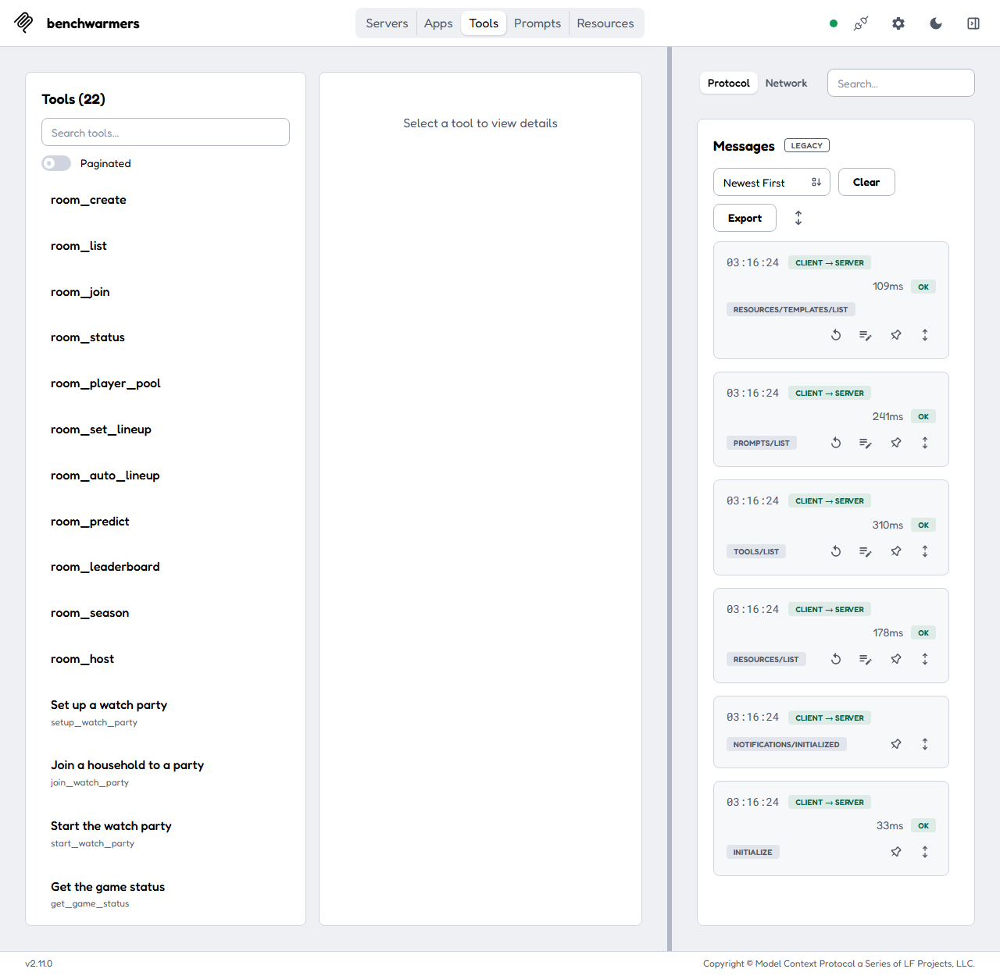
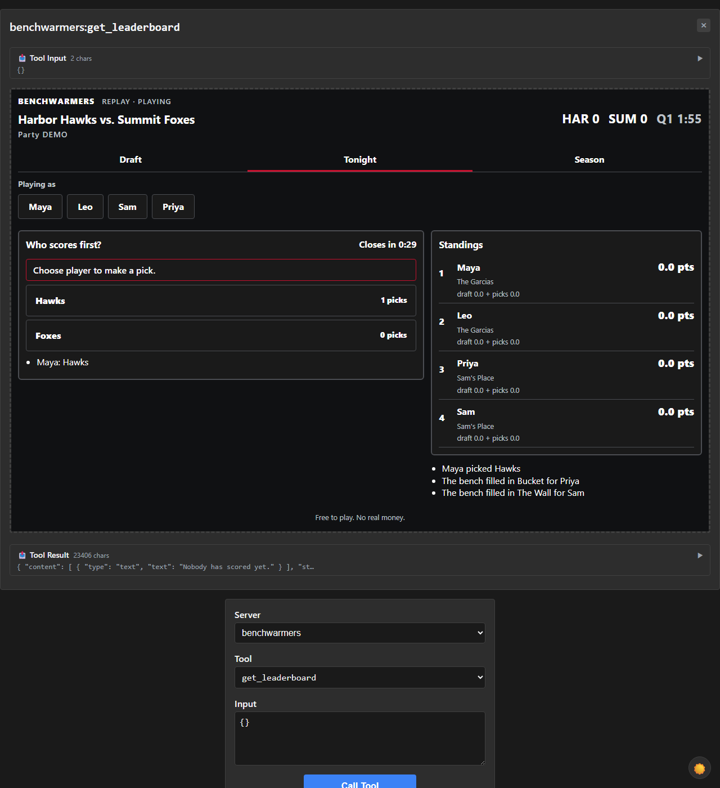
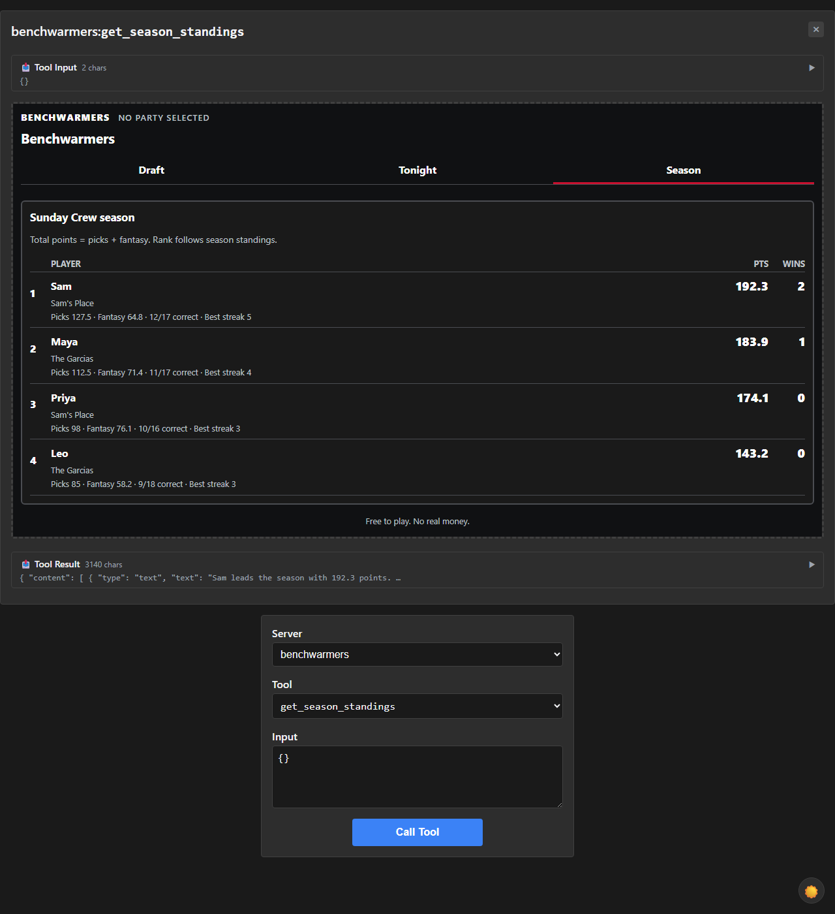

# Benchwarmers

A one-night fantasy draft plus live pick'em for watching sports with friends, played by voice. It is built as an Alexa+ add-on for a hackathon (Alexa+ track, AWS Builder mini challenge).

Households in different cities join one watch party. Each person drafts three players, then answers short live questions ("Who scores first?") as a simulated game plays out. Points feed a per-night leaderboard and a season table. It is free to play: no real money, no wagers, no real teams or leagues (the demo game is Harbor Hawks vs. Summit Foxes).


## Architecture



- The device page simulates an Alexa+ device. It posts the utterance to `/api/assistant`, which acts as an MCP client against the server's own `/mcp` endpoint. The assistant is `offline` (rule-based), `gemini`, or `bedrock`, with the same tools in every mode.
- The TV view is a big-screen display that polls the REST state. It does not use MCP.
- AI content (question text, recaps, explanations, scouting notes) is generated by a background worker, not inside a tool call. Tools answer from the engine and store.
- Voice ID runs in the browser: WavLM embeddings in a worker, with an MFCC fallback. Audio and embeddings stay on the device; only a `SpeakerHint` goes to the server. See [docs/VOICE_ID.md](docs/VOICE_ID.md).

### MCP surface

Protocol `2025-11-25` over Streamable HTTP, stateless (a fresh server per request), at `/mcp`. Auth is a static bearer token (`Authorization: Bearer <MCP_TOKEN>`).

Tools (11): `setup_watch_party`, `join_watch_party`, `start_watch_party`, `get_game_status`, `explain_last_result`, `get_my_roster`, `list_available_players`, `draft_player`, `make_pick`, `get_leaderboard`, `get_season_standings`.

Five of them (`list_available_players`, `draft_player`, `make_pick`, `get_leaderboard`, `get_season_standings`) are registered as app tools and render the MCP App widget at `ui://benchwarmers/board.html` (single-file HTML with Draft board, Tonight and Season tabs).

Prompt: `watch_party_host`. Resource: `benchwarmers://rules`.

## Quick start

Requires Node >= 22 and npm.

```bash
npm ci
npm run demo
```

`npm run demo` builds the MCP widget, then starts the server (game speed 4x) and the Vite web app together. Ctrl+C stops both.

| URL | What |
|---|---|
| http://localhost:5173/tv/DEMO | TV view for the seeded `DEMO` party |
| http://localhost:5173/device/garcias | Device simulator, The Garcias (Maya, Leo) |
| http://localhost:5173/device/sams-place | Device simulator, Sam's Place (Sam, Priya) |
| http://localhost:5173/voice-lab | Voice ID lab |
| http://localhost:3001/mcp | MCP endpoint (bearer required) |
| http://localhost:3001/healthz | Health check |

`npm run demo:reset` restores the `DEMO` party and season stats to seed (`POST /api/parties/DEMO/reset`).

Demo overrides: `PORT` (server, default 3001), `WEB_PORT` (web, default 5173), `SPEED` (game seconds per real second, default 4). Variables already in the shell win over the root `.env`.

Platform notes:
- Windows: use Git Bash or PowerShell. PowerShell: `$env:SPEED = "8"; npm run demo`. Git Bash: `SPEED=8 npm run demo`. The npm scripts avoid bash-only syntax.
- macOS / Linux: the Bash form works as written.
- `npm run dev` starts server and web in watch mode without building the widget first.

### Demo mode

The defaults need no network or credentials: `AI_MODE=fallback` uses committed content and `ASSISTANT_MODE=offline` uses a rule-based router that handles the demo utterances. At `SPEED=4` a game finishes in about two minutes. Reset with `npm run demo:reset`, or make a fresh party with `setup_watch_party`.

## Configuration

Copy `.env.example` to `.env` in the repo root; the server loads it at startup.

| Variable | Default | Meaning |
|---|---|---|
| `PORT` | `3001` | Server port |
| `SPEED` | `4` | Game seconds per real second |
| `MCP_TOKEN` | `dev-token-change-me` | Bearer token MCP clients must send |
| `DATA_FILE` | `data/store.json` | JSON store path (relative to the working directory) |
| `AI_MODE` | `fallback` | Content source: `fallback`, `gemini`, or `bedrock` |
| `AWS_REGION` | `us-east-1` | Region for Bedrock |
| `BEDROCK_MODEL_ID` | empty | A Haiku-tier Claude inference profile id |
| `ASSISTANT_MODE` | `offline` | Device assistant: `offline`, `gemini`, or `bedrock` |
| `GEMINI_API_KEY` | empty | One Gemini key |
| `GEMINI_API_KEYS` | empty | Comma-separated key pool; takes precedence over `GEMINI_API_KEY` |
| `GEMINI_MODEL_ID` | `gemini-3.8-flash` | Gemini model |
| `GEMINI_KEY_COOLDOWN_MS` | `60000` | Shared cooldown after a quota, server or network failure |
| `GEMINI_TIMEOUT_MS` | `60000` | Overall deadline for one model request, including key failover |
| `ALLOWED_HOSTS` | unset | Optional comma-separated Host header allowlist for `/mcp` (not in `.env.example`). Unset means no host check. If you set it, include your tunnel hostname. |
| `WEB_PORT` | `5173` | Web dev server port (read by `npm run demo`) |
| `BW_API_URL` | `http://localhost:3001` | Where the Vite server proxies `/api`, `/mcp` and `/healthz`; `npm run demo` sets it from `PORT` |

Optional log switches: `AI_LOG=0` and `ASSISTANT_LOG=0` silence AI and assistant logging.

## Connecting MCP hosts

Start the server, then use any of these. Step-by-step instructions, patches and more screenshots are in [docs/MCP_HOSTS.md](docs/MCP_HOSTS.md).

- MCP Inspector: `npx @modelcontextprotocol/inspector`, add a Streamable HTTP server at `http://localhost:3001/mcp`, and set the `Authorization: Bearer dev-token-change-me` header under Server Settings. Tools load on connect; there should be 11.
- ext-apps basic-host (`@modelcontextprotocol/ext-apps` v2.0.3): renders the widget. It needs a small local patch to send the bearer header; see the doc.
- Public tunnel: `cloudflared tunnel --url http://localhost:3001`, then use the `trycloudflare.com` URL plus `/mcp` with the bearer header. Without the bearer the server returns 401.



| Tonight (live picks) | Season standings |
|---|---|
|  |  |

## Second game: football, drive odds and pick bonuses

A second replay game, **Riverton Otters at Ironwood Forge** (`riverton-vs-ironwood`), is a fictional football game. Say "set up a watch party for the football game with the Sunday Crew". `DEMO` stays the basketball game. Its live questions are drive questions ("Will the Otters score on this drive?"). Each carries a historical percentage from a table of 64,085 real drives (nflverse play-by-play 2015–2025, CC-BY 4.0), bucketed by starting field position and clock. The table is built by `tools/odds/build_drive_odds.py`; see [tools/odds/README.md](tools/odds/README.md). Percentages are precomputed into the replay data, so no tool computes them live.

Correct picks in both games earn points multipliers on top of the streak multiplier:

| Bonus | When | Multiplier |
|---|---|---|
| Early call / Quick call | picked in the first 25% / 60% of the open window | ×1.25 / ×1.10 |
| Lone call / Against the room | only picker of that option (3+ pickers) / under half the pickers (2+) | ×1.5 / ×1.2 |
| Bold call (football drive questions) | `0.5 / p` of the option picked, clamped to 0.5–2 | up to ×2 |

The combined multiplier is capped at ×5 (50 points per pick). Full rules: `benchwarmers://rules`, plan.md §10c.

## Pull up a real game

Type a matchup on the home page ("UVA vs FSU 2025") and the server replays that real, finished football game for the crew. Committed demo games and seed data stay fictional; only this runtime importer touches real teams.

How it works: `POST /api/games/import { "query": "UVA vs FSU 2025" }` resolves two teams (abbreviation, school, nickname or a few aliases such as UVA) and a season, or takes an ESPN event id or game URL. It reads the team schedule and picks the most recent completed meeting, fetches the play-by-play summary and rosters, converts it to a replayable `Game` (`server/src/live/convert.ts`), builds about eight drive props from the real drives, and registers it. Scores come from the real score changes, so the replay ends on the real final, including overtime ("OT", "2OT" on the clock). Every import is cached in `server/data/imported-games/` (gitignored) and reloaded at startup, so parties survive restarts and a repeat import needs no network. `GET /api/games` lists committed and imported games; voice users can name an imported game by its title.

Data source: ESPN's public, keyless JSON (site.api.espn.com), college football first, then the NFL.

Limits: finished games only (live in-progress games are not streamed yet); ESPN's endpoints are unofficial and may change or rate-limit; play text is parsed, so a few names ESPN spells differently in the box score and the play text get no fantasy credit (the play still shows); props are drive questions only.

## TV view

`/tv/:code` is a big-screen display of a party. It shows the draft, live questions and results, rosters and final standings by polling the REST state; `/tv/latest` follows the newest party. Its look is being redesigned separately, so see the running app rather than screenshots.

## Voice ID

The device page can tell household members apart by voice, so nobody has to say "I'm Maya". Enrollment, matching and thresholds all run in the browser (WavLM x-vector in a worker, MFCC fallback). The server receives only a `SpeakerHint`. Details, measurements and limits: [docs/VOICE_ID.md](docs/VOICE_ID.md). Try it at `/voice-lab`.

## AI modes

- `fallback` / `offline` (default): committed content and a rule-based router. No network, no credentials.
- `gemini`: Google Gemini for content and/or the assistant, with key-pool failover. Keys stay server-side. Setup: [docs/GEMINI.md](docs/GEMINI.md).
- `bedrock`: Amazon Bedrock Converse (Claude Haiku tier) for content and/or the assistant. Setup, cost guard and guardrails: [docs/AWS.md](docs/AWS.md).

If a model call fails, the assistant falls back to the offline router and content falls back to the committed set.

## Tests

```bash
npm test                  # server (672 tests), then web (278 tests)
npm run typecheck
npm run play -w server    # scripted full party, prints standings
npm run play -w server -- --game riverton-vs-ironwood   # same, football
```

Counts come from the last recorded run (`docs/HANDOFF.md`). The server suite was occasionally flaky on one machine with antivirus loopback interception; re-run if it stalls.

## Known gaps

- Alexa+ Private Preview onboarding is not done. The device is a browser simulation, and the widget has never been opened in a real Alexa+ host.
- Auth is a single static bearer token. There is no OAuth/OIDC.
- Node >= 22 is required.
- Real Bedrock has never been called; it is tested only with mocks.
- Voice ID has not been tried with a real microphone or real people.
- COOP/COEP headers (for threaded WASM) are set only by the Vite dev and preview servers.
- The TV view is not football-aware yet (it draws a basketball court and shows no drive odds or bonus chips); the widget and device page are.

## Repository layout

- `server/` Express 5 + TypeScript: engine, store, REST, MCP, widget, AI, assistant
- `web/` Vite + React 19: TV view, device page, voice lab
- `docs/` host checks, voice ID, Gemini, AWS, friction log, handoff
- `plan.md` original product spec

## License

[MIT](LICENSE). Repository: https://github.com/Azrkiel/Benchwarmers
