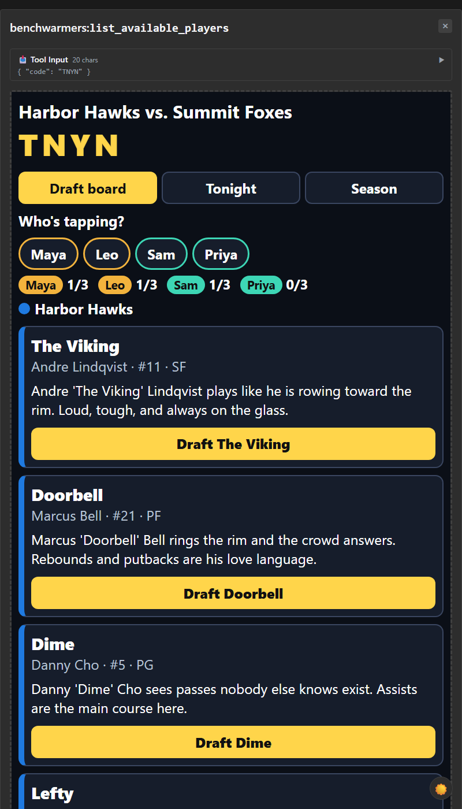

# MCP host checks (phase 2b, 2026-10-20)

Server under test: `cd server && PORT=3001 SPEED=4 DATA_FILE=<tmp>/s.json npx tsx src/index.ts`
Endpoint `http://localhost:3001/mcp` (Streamable HTTP, stateless), header `Authorization: Bearer dev-token-change-me`.
Protocol negotiated: `2025-11-25`. No Avast hang seen on `localhost` in these runs (`forceChunked` stays in `http.ts`).

## 1. MCP Inspector 2.11.0

```
npx @modelcontextprotocol/inspector
```
Add server -> Streamable HTTP -> `http://localhost:3001/mcp`; add the bearer header under Server Settings > Custom Headers
(not in the Add dialog). Tools load automatically on connect (no "List Tools" button in 2.x).


CLI mode (used for the Checkpoint 2 flow; full output in [img/inspector-flow.txt](img/inspector-flow.txt)):
```
npx @modelcontextprotocol/inspector --cli http://localhost:3001/mcp --transport http \
  --header "Authorization: Bearer dev-token-change-me" \
  --method tools/call --tool-name setup_watch_party --tool-arg crewName="Sunday Crew" ...
```
Verified: setup -> join (idempotent) -> list_available_players -> draft_player (incl. `PLAYER_TAKEN` conflict with
alternatives) -> start_watch_party -> make_pick (needs the live `propId`) -> get_leaderboard (draft + pick points) ->
get_season_standings (the finished night folds into the season, order changed).

Quirks: CLI exits 5 and prints only `tool_is_error` on stderr for `isError` results (details are in stdout JSON);
`npx` startup (~2.5 s) can miss the pick window at SPEED=4, so call the CLI's `index.js` directly.

## 2. ext-apps basic-host (tag v2.0.3, matches our `@modelcontextprotocol/ext-apps` 2.0.3)

Use a fresh temp dir outside this repo.
```
git clone https://github.com/modelcontextprotocol/ext-apps && cd ext-apps && git checkout v2.0.3
cd examples/basic-host
# patch src/implementation.ts:
#  1. StreamableHTTPClientTransport(serverUrl, { requestInit: { headers: { Authorization: "Bearer dev-token-change-me" } } })
#  2. SANDBOX_PROXY_BASE_URL localhost:8081 -> localhost:8181
npm install --no-workspaces --no-audit --no-fund
INPUT=index.html npx vite build; INPUT=sandbox.html npx vite build     # `npm run build` fails: tsc needs @types/cors
HOST_PORT=8180 SANDBOX_PORT=8181 SERVERS='["http://localhost:3001/mcp"]' npx tsx serve.ts   # `npm start` needs bun
```
Open `http://localhost:8180`, pick a tool, enter JSON args, "Call Tool" (the second button; the first is the theme toggle).
Views: draft = `list_available_players`/`draft_player`; tonight = `get_leaderboard`/`make_pick` (`get_game_status` has no widget
`_meta`); season = `get_season_standings`. In-widget tabs: Draft board / Tonight / Season.

| View | ~800 px | ~1280 px |
|---|---|---|
| Draft |  |  |
| Tonight |  |  |
| Season |  |  |

Re-shot 2026-10-22 (ESPN dark look, basic-host + Inspector 2.11.0 Apps tab). Observations: single column at 800 (widget about 760 px wide), two columns at 1280. The breakpoint is `min-width:1000px` on the
widget's own width, so it switches correctly between the two host sizes. No widget console errors. The only logs are
`404 /favicon.ico` and `405 GET /mcp` (the host probes for a standalone SSE stream; our stateless server doesn't offer one; harmless).

Widget bug found and fixed: season rows rendered five adjacent `.split` spans with no separators ("best streak 4 nights won 2
12/18 correct"). Now one span joined with `&middot;` (`server/src/mcp/widget/src/render.ts`).

## 3. cloudflared quick tunnel
```
~/Downloads/cloudflared-windows-amd64.exe tunnel --url http://localhost:3001
curl -s -X POST https://<name>.trycloudflare.com/mcp -H "Authorization: Bearer dev-token-change-me" \
  -H "Content-Type: application/json" -H "Accept: application/json, text/event-stream" \
  -d '{"jsonrpc":"2.0","id":1,"method":"initialize","params":{"protocolVersion":"2025-11-25","capabilities":{},"clientInfo":{"name":"tunnel-check","version":"1"}}}'
```
Result: HTTP 200, `text/event-stream`, `"protocolVersion":"2025-11-25"`, serverInfo `benchwarmers 0.1.0`. Without the bearer: 401.
`ALLOWED_HOSTS` was not set, so no host check ran. If you set it, include the tunnel hostname (`http.ts` `hostHeaderValidation`).

## Notes
- `get_leaderboard` returns about 34 KB of structuredContent (full party state).
- A game at SPEED=4 finishes in about 2 min; make a new party (`setup_watch_party`) for a fresh draft screenshot.
