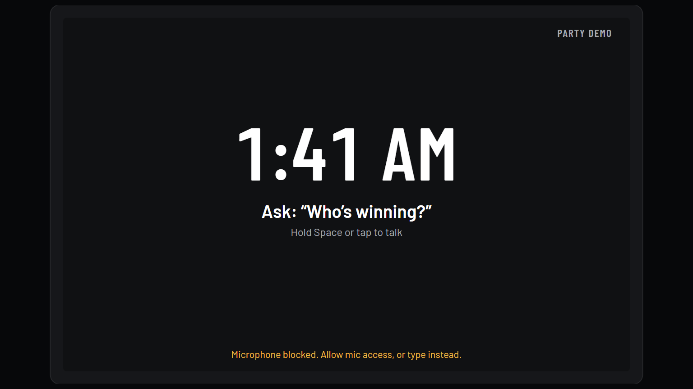

# Smart display hold-to-talk regression (2026-10-23)

Report: the listening indicator disappears while Space is still held.

The display shared the device page's single-utterance recognizer (`continuous = false`), so recognition could finish before key release. The key-up handler also depended on rendered `listening` state, missing a very fast press/release, and clean mode hid speech errors with its footer.

Holding Space now starts continuous recognition. The key gesture is tracked independently of React rendering: repeated key-downs do not restart it, key release stops it, and window blur releases it. Final phrases are joined with spaces and sent once after recognition ends. Tap-to-talk retains single-utterance recognition. Microphone/service errors appear inside the display, including `?clean=1`; start exceptions also report an error and end the voice-ID capture.

Checks:

- New regression tests failed before each fix: early end while holding, rapid release, window blur, hidden clean-mode error, joined phrases, and failed microphone startup.
- Typecheck, all 500 web tests, production build and `git diff --check` pass.
- Headless Chrome at 1536x864: native keyboard events hold Space for one second through a final phrase, with no assistant request until release. Releasing sends one request and stops once. A simulated permission failure remains visible inside the clean display. No page exceptions.
- The browser lifecycle test injects a recognizer and uses fake microphone media. It verifies keyboard, rendering and send timing, not real-microphone recognition or the availability of Chrome's external speech service.
- Code, security and cleanup review: no blocking findings. The default device-page recognition mode is unchanged; holding stops on release or loss of focus; no server, auth or credential changes.

Request/timing evidence: [browser lifecycle result](screens/display-hold-space-local.json).
