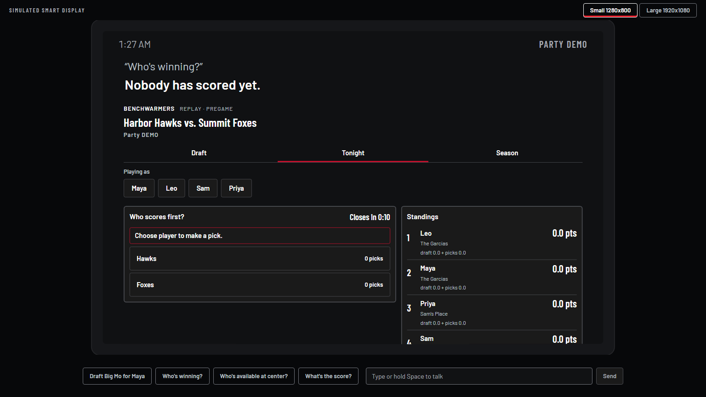
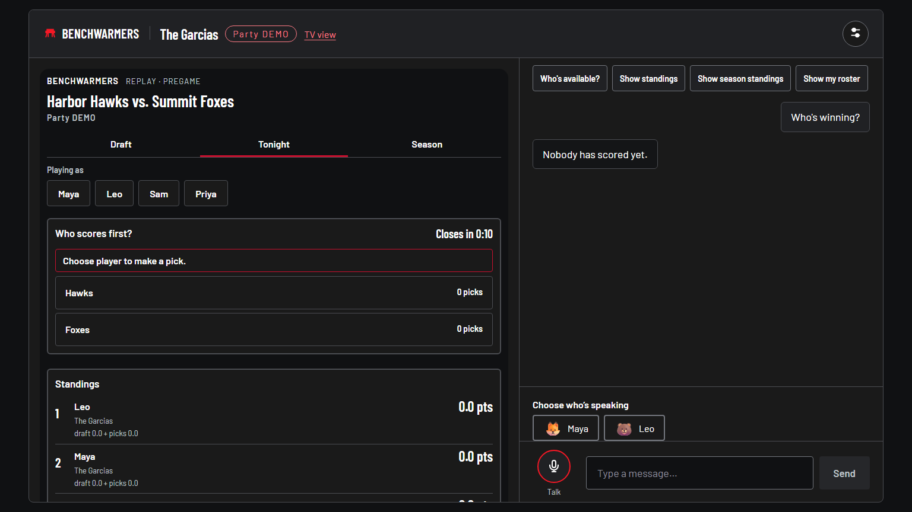
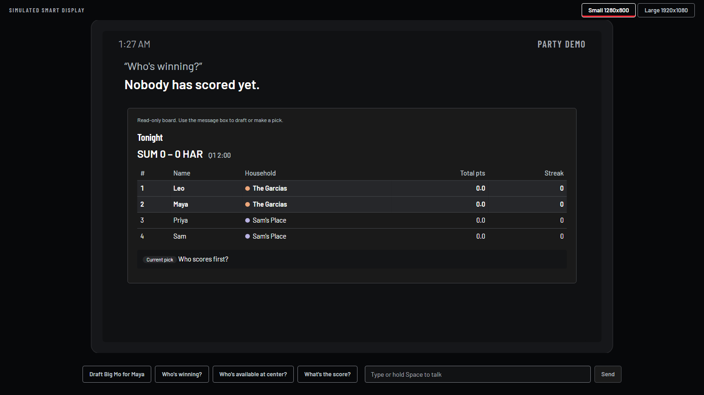

# Browser widget host verification (2026-10-23)

## Regression and fix

Production `/display/garcias`, prompted with `Who's winning?`, sent a browser bearer to `/mcp` and received 401. The failed iframe retained its own flex slot, so the separate fallback started 259 CSS pixels below the spoken reply at the laptop viewport, 1536x864.

The browser now uses `/api/mcp-widget`. The server adds its bearer and forwards in-process to the existing MCP middleware and handler. `/mcp` still requires a bearer. The fallback shares the widget's single layout slot.

## Automated checks

- `npm run typecheck`: server, widget and web pass.
- `npm run test -w web`: 494 tests pass (59 files).
- `npm test -w server -- --maxWorkers=6`: 744 tests pass (39 files).
- `npm run build`: passes; the existing large-chunk advisory remains.
- `git diff --check`: passes.

HTTP regression coverage: a non-development server token; all 22 tools; a real Tonight tool result and HTML resource read; no token in responses; an invalid room host credential still denied; foreign, opaque and cross-scheme Origins rejected; Fly's forwarded HTTPS accepted; malformed JSON and unsupported methods retain their protocol errors; unauthenticated `/mcp` stays 401.

One full-suite run hit the previously documented Avast/loopback `ECONNRESET` on the existing health check. The unchanged check passed on rerun. No test retries or relaxed assertions were added.

Fresh-clone check of release `16d2aad`: a separate checkout in `%TEMP%/bw-widget-fresh-20261023` fetched GitHub `main`, installed 294 packages from the lockfile in 37 seconds, then passed typecheck, 494 web tests, 744 server tests, the offline `npm run play -w server` flow, and the production build. Finished in under 3 minutes, with no `.env` copied from the working tree. The game finished Harbor 57-56 Summit; Big Mo was Benchwarmer of the night. The fresh server suite passed on its first run.

## Browser checks

Headless Chrome, 1536x864 CSS viewport, production web build served by Express with a non-development MCP token and offline/fallback modes. Each host received the typed prompt `Who's winning?`; its sandboxed MCP App loaded Tonight, switched to Season, then back to Tonight. Both display sizes and `/device/garcias` worked with no page exceptions. Browser MCP requests had no Authorization header. POST returned 200/202; the SDK's optional GET stream probe returned the expected 405.

With MCP requests deliberately failed, the fallback began 9 CSS pixels after the reply, in one widget slot. It remained readable with its standings intact.

## Production verification

Deployed 2026-10-23 at about 01:27 ET from clean detached GitHub `main` release `16d2aad`, using `flyctl deploy --app benchwarmers --remote-only --depot=false --ha=false` and the committed always-on configuration. Image: `deployment-01M5KKEMA21E1Q0NKZYNCKHF5Z`. Machine `857729eb24e728`, version 5, started with one passing health check.

At `https://benchwarmers.fly.dev`, headless Chrome repeated the typed prompt and Tonight -> Season -> Tonight interactions on both display sizes and `/device/garcias`, with no page exceptions. The browser sent no MCP bearer. The real widget rendered and the fallback was absent.

| Production check | Result |
| --- | --- |
| `POST /mcp`, no bearer | 401 |
| `POST /mcp`, development bearer | 401 |
| Browser endpoint, foreign Origin | 403 |
| Browser endpoint, same-origin initialize | 200; protocol 2025-11-25 |
| `tools/list` through browser host | 22 tools |
| `/healthz` | 200 |
| Forced MCP failure on display | One layout slot; fallback 9 px below reply |

The Node HTTPS probe used `--use-system-ca` for this Windows machine's certificate store, retaining TLS validation. The initial probe without it hit the existing `UNABLE_TO_VERIFY_LEAF_SIGNATURE` issue described in `FRICTION_LOG.md`; Chrome and Fly checks were unaffected.

Screenshot-adjacent JSON files contain request/status evidence and measured layout bounds. Tall widget content still scrolls within the display as noted in the handoff; this pass fixes auth and fallback placement.

## Review

Code, security and cleanup passes found no remaining blocking issue. Forwarding reuses the request parser, size limit, host allowlist, bearer check, transport and cleanup rather than opening a second network hop. The endpoint is intentionally a public demo host, like the public REST API; Origin filtering is a browser safeguard, not user authentication. External clients can call the public demo host without a bearer, and room host/participant authorization remains enforced by the tools. No production secret is copied into web assets or responses.

Recording, real-microphone voice-ID proof, and Alexa+ device/host proof were not performed. The submission's UNVERIFIED statements remain.

## Handoff tasks remaining

1. Owner: record the demo from production, using F11 at normal zoom. Say "simulated smart display", show about 15 seconds of MCP Inspector with 22 tools, and draft Big Mo only once per take.
2. Owner: upload the English video publicly (under 3 minutes), add its URL and the Devpost draft URL to `SUBMISSION.md`, re-read the UNVERIFIED statements, and submit by 10:00 AM PT (hard deadline 12:00 PM PT).
3. Optional owner checks: scan the room TV QR with a physical phone; remove old test rooms if desired. No production rooms were created, reset or deleted in this verification.
